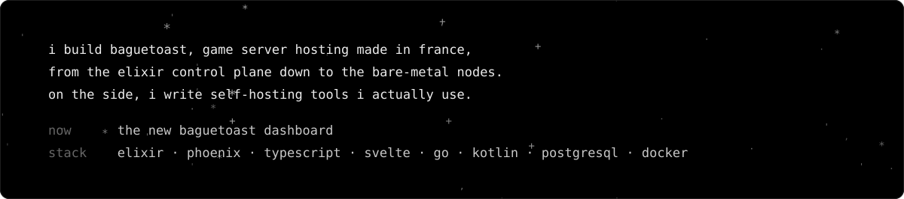
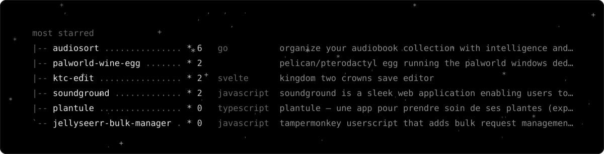
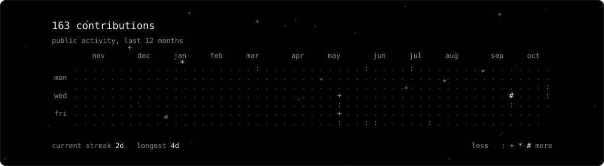

  
  
  
  

  
    <!-- top-repos:start -->
    <a href="https://github.com/lxwiq/AudioSort">audiosort</a> ·
    <a href="https://github.com/lxwiq/palworld-wine-egg">palworld-wine-egg</a> ·
    <a href="https://github.com/lxwiq/ktc-edit">ktc-edit</a> ·
    <a href="https://github.com/lxwiq/soundground">soundground</a> ·
    <a href="https://github.com/lxwiq/plantule">plantule</a> ·
    <a href="https://github.com/lxwiq/jellyseerr-bulk-manager">jellyseerr-bulk-manager</a>
    <!-- top-repos:end -->
  

  
    <a href="https://baguetoast.com">baguetoast.com</a> ·
    <a href="mailto:loic.aviez91@gmail.com">loic.aviez91@gmail.com</a>
  

