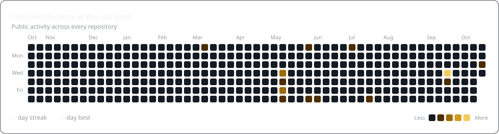

<picture>
  <source media="(prefers-color-scheme: dark)" srcset="./assets/header-dark.svg">
  <source media="(prefers-color-scheme: light)" srcset="./assets/header-light.svg">
  
</picture>

I build [Baguetoast](https://baguetoast.com), game server hosting made in France — from the Elixir control plane down to the bare-metal nodes. On the side, I write self-hosting tools I actually use.

**Currently** working on the new Baguetoast dashboard and our Pelican Wings orchestration layer.

**Stack** — Elixir, Phoenix, TypeScript, Svelte, Go, Kotlin, PostgreSQL, Docker.

**Side projects**

- [AudioSort](https://github.com/lxwiq/AudioSort) — organises audiobook collections
- [palworld-wine-egg](https://github.com/lxwiq/palworld-wine-egg) — Palworld's Windows server under Wine, so mods load
- [jellyseerr-bulk-manager](https://github.com/lxwiq/jellyseerr-bulk-manager) — bulk request management for Jellyseerr
- [ktc-edit](https://github.com/lxwiq/ktc-edit) — Kingdom Two Crowns save editor in the browser

 

<picture>
  <source media="(prefers-color-scheme: dark)" srcset="./assets/calendar-dark.svg">
  <source media="(prefers-color-scheme: light)" srcset="./assets/calendar-light.svg">
  
</picture>

[baguetoast.com](https://baguetoast.com) · [loic.aviez91@gmail.com](mailto:loic.aviez91@gmail.com)
